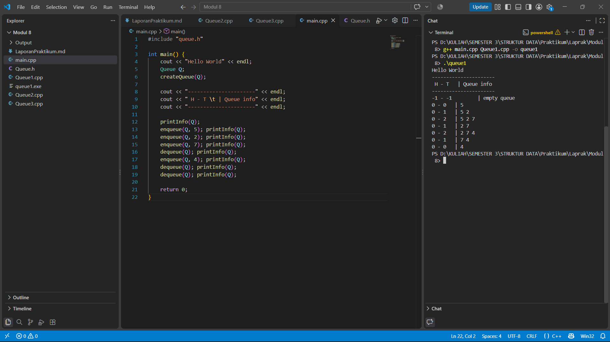
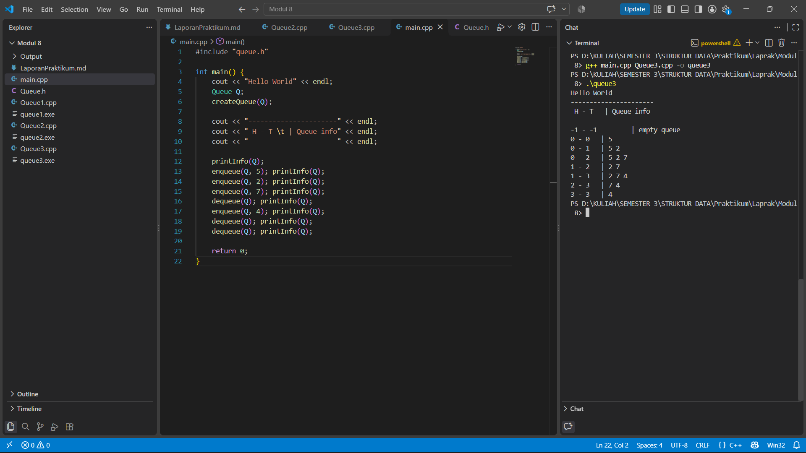

# <h1 align="center">Laporan Praktikum Modul 8 - QUEUE </h1>

<p align="center">Imroatun Sholikha - 109082500111</p>

## **Dasar Teori**

Queue atau antrean merupakan struktur data linear yang menggunakan prinsip FIFO (First In First Out), yaitu data yang pertama masuk akan menjadi data pertama yang keluar. Queue digunakan untuk mengatur urutan pemrosesan data, seperti antrean pada kasir atau loket pelayanan [1][2].

Queue memiliki dua bagian utama, yaitu Head (Front) sebagai posisi elemen pertama dan Tail (Rear) sebagai posisi elemen terakhir. Penambahan data dilakukan melalui Tail, sedangkan penghapusan dilakukan melalui Head. Queue dapat diimplementasikan menggunakan array maupun linked list [1].

**A. Enqueue (Insert)**

Enqueue merupakan operasi untuk menambahkan elemen baru ke bagian belakang queue (Tail). Jika queue masih kosong, elemen baru akan menjadi Head sekaligus Tail [1].

**B. Dequeue (Delete)**

Dequeue merupakan operasi untuk menghapus elemen paling depan (Head). Setelah elemen dihapus, Head berpindah ke elemen berikutnya. Operasi ini hanya dapat dilakukan jika queue tidak kosong [1].


## Guided

### 1. 


## queue.h

```C++

#ifndef QUEUE_H
#define QUEUE_H

#include <iostream>
#include <string>
using namespace std;

struct Node {
    string nama;
    Node *next;
};

struct queue {
    Node *head, *tail;
};

void CreateQueue(queue &Q);
bool isEmpty(queue Q);
bool isFull(queue Q);
void enQueue(queue &Q, const string &nama);
void deQueue(queue &Q);
void viewQueue(queue Q);
void clearQueue(queue &Q);
#endif


```

## queue.cpp

```C++


#include "queue.h"

void CreateQueue(queue &Q)
{
    Q.head = Q.tail = nullptr;
}

bool isEmpty(queue Q)
{
    return Q.head == nullptr;
}

bool isFull(queue Q)
{
    int maxQueue = 20;
    int counter = 0;
    Node *nodeBantu = Q.head;

    while (nodeBantu != nullptr)
    {
        counter++;
        nodeBantu = nodeBantu->next;
    }

    return counter >= maxQueue;
}

void enqueue(queue &Q, const string &nama)
{
    if (isFull(Q))
    {
        cout << "Queue penuh";
    }
    else if (isEmpty(Q))
    {
        Node *nodeBaru = new Node;
        nodeBaru->nama = nama;
        nodeBaru->next = nullptr;

        Q.head = Q.tail = nodeBaru;
    }
    else
    {
        Node *nodeBaru = new Node;
        nodeBaru->nama = nama;
        nodeBaru->next = nullptr;

        Q.tail->next = nodeBaru;
        Q.tail = nodeBaru;
    }
}

void deQueue(queue &Q)
{
    if (isEmpty(Q))
    {
        cout << "Queue kosong";
    }
    else
    {
        Node *nodeHapus = Q.head;
        Q.head = Q.head->next;

        if (Q.head == nullptr)
        {
            Q.tail = nullptr;
        }

        delete nodeHapus;
    }
}

void viewQueue(queue Q)
{
    if (isEmpty(Q))
    {
        cout << "Queue kosong";
    }
    else
    {
        Node *nodeBantu = Q.head;

        while (nodeBantu != nullptr)
        {
            cout << "Nama : " << nodeBantu->nama << endl;
            nodeBantu = nodeBantu->next;
        }
    }
}

void clearQueue(queue &Q)
{
    if (isEmpty(Q))
    {
        cout << "Queue kosong";
    }
    else
    {
        while (!isEmpty(Q))
        {
            deQueue(Q);
        }
    }
}


```

## main.cpp

```C++

#include "queue.h"
#include <iostream>
using namespace std;

int main()
{
    queue Q;
    CreateQueue(Q);

    enQueue(Q, "Gilar");
    enQueue(Q, "Aflah");
    enQueue(Q, "Aedil");
    enQueue(Q, "Fatir");
    enQueue(Q, "Kevin");
    enQueue(Q, "Fathir");
    enQueue(Q, "Zulfa");

    cout << "--- Isi Queue Setelah enQueue ---" << endl;
    viewQueue(Q);

    deQueue(Q);
    deQueue(Q);
    deQueue(Q);
    deQueue(Q);
    cout << endl;

    cout << "--- Isi Queue Setelah deQueue ---" << endl;

    viewQueue(Q);

    clearQueue(Q);

    return 0;
}


```

## Guided

### 2


## queue.h

```C++

#ifndef QUEUE_H
#define QUEUE_H

#include <iostream>
#include <string>
using namespace std;

const int MAX = 5;

struct queue {
    string nama[MAX];
    int head;
    int tail;
};

bool isEmpty(queue Q);
bool isFull(queue Q);
void createQueue(queue &Q);
void enQueue(queue &Q, string nama);
void deQueue(queue &Q);
void viewQueue(queue Q);

#endif


```

## queue.cpp

```C++


#include "queue.h"
#include <iostream>

using namespace std;

// NOTE : 
// Implementasi 1 = head diam, tail bergerak (Queue Linear Statis, kerana head nya tetap diam)
// Implementasi 2 = head bergerak, tail bergerak (Queue Linear Dinamis, karena head & tail nya sama-sama bergerak)
// Implementasi 3 = head dan tail berputar (Queue Circular, karena jika udh mentok tapi masih ada space, diputar sehingga tail bisa ada didepan head)

bool isEmpty(queue Q){
    if(Q.head == -1 && Q.tail == -1){
        return true;
    } else {
        return false;
    }
}

//isFull implmenetasi 1 & 2
bool isFull(queue Q){
    if(Q.tail == MAKSIMAL - 1){
        return true;
    } else {
        return false;
    }
}

// //isFull implementasi 3
// bool isFull(queue Q){
//     if((Q.tail + 1) % MAKSIMAL == Q.head){
//         return true;
//     } else {
//         return false;
//     }
// }

void CreateQueue(queue &Q){ //terbentuk queue dengan head = -1 dan tail = -1 
    Q.head = -1;
    Q.tail = -1;
}
 

//enqueue implementasi 1 & 2
void enQueue(queue &Q, string nama){
    if(isFull(Q) == true){
        cout << "Queue sudah penuh!" << endl;
    } else {
        if(isEmpty(Q) == true){
            Q.head = Q.tail = 0;
        } else {
            Q.tail++;
        }
        Q.nama[Q.tail] = nama;
        cout << "nama " << nama << " berhasil ditambahkan kedalam queue!" << endl;
    }
}

// //enQueue implementasi 3
// void enQueue(queue &Q, string nama){
//     if(isFull(Q) == true){
//         cout << "Queue sudah penuh!" << endl;
//     } else {
//         if(isEmpty(Q) == true){
//             Q.head = Q.tail = 0;
//         } else {
//             Q.tail = (Q.tail + 1) % MAKSIMAL; // bergerak melingkar
//         }
//         Q.nama[Q.tail] = nama;
//         cout << "nama " << nama << " berhasil ditambahkan kedalam queue!" << endl;
//     }
// }

//dequeue implementasi 1
void deQueue(queue &Q){
    if(isEmpty(Q) == true){
        cout << "Queue kosong!" << endl;
    } else {
        cout << "Mengahapus data " << Q.nama[Q.head] << "..." << endl;
        for(int i = 0; i < Q.tail; i++){
            Q.nama[i] =  Q.nama[i+1];
        }
        Q.tail--;
        if(Q.tail < 0){ //kalo semua isi queue nya udh dikeluarin, set head & tail ke -1
            Q.head = -1;
            Q.tail = -1;
        }
    }
}

// //dequeue implementasi 2
// void deQueue(queue &Q){
//     if(isEmpty(Q) == true){
//         cout << "Queue kosong!" << endl;
//     } else {
//         cout << "Mengahapus data " << Q.nama[Q.head] << "..." << endl;
//         Q.head++;
//         if(Q.head > Q.tail){ //kalo elemennya udh abis (head akan lebih 1 dari tail), maka reset ulang head & tail ke -1
//             Q.head = -1;
//             Q.tail = -1;
//         }
//     }
// }

// //deQueue implementasi 3
// void deQueue(queue &Q){
//     if(isEmpty(Q) == true){
//         cout << "Queue kosong!" << endl;
//     } else {
//         cout << "Mengahapus data " << Q.nama[Q.head] << "..." << endl;
//         if(Q.head == Q.tail){ //kalo elemennya tinggal 1, langsungkan saja head & tail nya reset ke -1
//             Q.head = -1;
//             Q.tail = -1;
//         } else {
//             Q.head = (Q.head + 1) % MAKSIMAL; // bergerak melingkar
//         }
//     }
// }

//viewQueue implementasi 1 & 2
void viewQueue(queue Q){
    if(isEmpty(Q) == true){
        cout << "Queue kosong!" << endl;
    } else {
        for(int i = Q.head; i <= Q.tail; i++){
            cout << i -  Q.head + 1 << ". " << Q.nama[i] << endl;
        }
    }
    cout << endl;
}

// //viewQueue implementasi 3
// void viewQueue(queue Q){
//     if(isEmpty(Q) == true){
//         cout << "Queue kosong!" << endl;
//     } else {
//         int i = Q.head;
//         int count = 1;
//         while(true){
//             cout << count << ". " << Q.nama[i] << endl;
//             if(i == Q.tail){
//                 break;
//             }
//             i = (i + 1) % MAKSIMAL;
//             count++;
//         }   
//     }
// }


```

## main.cpp

```C++

#include "queue.h"
#include <iostream>

using namespace std;

int main(){
    queue Q;

    CreateQueue(Q);
    enQueue(Q, "Dimas");
    enQueue(Q, "Arvin");
    enQueue(Q, "Rizal");
    enQueue(Q, "Hafizh");
    enQueue(Q, "Fathur");
    enQueue(Q, "Daffa");
    cout << endl;

    cout << "--- Isi Queue Setelah enQueue ---" << endl;
    viewQueue(Q);
    cout << endl;

    deQueue(Q);
    deQueue(Q);
    deQueue(Q);
    deQueue(Q);
    // deQueue(Q);
    // deQueue(Q);
    cout << endl;

    cout << "--- Isi Queue Setelah deQueue ---" << endl;
    viewQueue(Q);

    return 0;
}

## Unguided

### 1. Buatlah ADT Queue menggunakan ARRAY sebagai berikut di dalam file “queue.h”:

## queue.h

```C++

#ifndef QUEUE_H_INCLUDED
#define QUEUE_H_INCLUDED

#include <iostream>
using namespace std;

const int MAX = 5;
typedef int infotype;

struct Queue {
    infotype info[MAX];
    int head, tail;
};

void createQueue(Queue &Q);
bool isEmptyQueue(Queue Q);
bool isFullQueue(Queue Q);
void enqueue(Queue &Q, infotype x);
infotype dequeue(Queue &Q);
void printInfo(Queue Q);

#endif // QUEUE_H_INCLUDED

#endif 

```
Kode header ini berisi deklarasi tipe data dan prototipe semua prosedur/fungsi. Queue terdiri dari array info berkapasitas 5 (indeks dimulai dari 0) serta head dan tail sebagai penunjuk elemen depan dan belakang. Queue kosong ditandai dengan head = -1 dan tail = -1. dequeue dibuat sebagai function yang mengembalikan infotype, sesuai soal. File ini dipakai bersama oleh ketiga alternatif.

## Queue1.cpp

```C++

#include "queue.h"

void createQueue(Queue &Q) {
    Q.head = -1;
    Q.tail = -1;
}

bool isEmptyQueue(Queue Q) {
    return Q.head == -1 && Q.tail == -1;
}

bool isFullQueue(Queue Q) {
    return Q.tail == MAX - 1;
}

void enqueue(Queue &Q, infotype x) {
    if (isFullQueue(Q)) {
        cout << "Queue penuh!" << endl;
        return;
    }
    if (isEmptyQueue(Q)) {
        Q.head = 0;
        Q.tail = 0;
    } else {
        Q.tail++;
    }
    Q.info[Q.tail] = x;
}

infotype dequeue(Queue &Q) {
    if (isEmptyQueue(Q)) {
        cout << "Queue kosong!" << endl;
        return -1;
    }
    infotype x = Q.info[Q.head];
    if (Q.head == Q.tail) {
        createQueue(Q);
    } else {
        for (int i = Q.head; i < Q.tail; i++) {
            Q.info[i] = Q.info[i + 1];
        }
        Q.tail--;
    }
    return x;
}

void printInfo(Queue Q) {
    cout << Q.head << " - " << Q.tail << " \t| ";
    if (isEmptyQueue(Q)) {
        cout << "empty queue";
    } else {
        for (int i = Q.head; i <= Q.tail; i++) {
            cout << Q.info[i] << " ";
        }
    }
    cout << endl;
}
```
Kode ini berisi implementasi Queue dengan mekanisme head diam dan tail bergerak. Selama queue tidak kosong, head selalu bernilai 0 dan hanya tail yang maju saat enqueue. Saat dequeue, elemen di head diambil, lalu semua elemen sisanya digeser satu posisi ke kiri dan tail dimundurkan. Jika hanya ada satu elemen, queue dikembalikan ke kondisi kosong (-1, -1). isFullQueue bernilai true jika tail sudah di indeks terakhir. printInfo menampilkan nilai head - tail diikuti isi queue dari head sampai tail, atau "empty queue" jika kosong.

## Queue2.cpp

```C++
#include "queue.h"

void createQueue(Queue &Q) {
    Q.head = -1;
    Q.tail = -1;
}

bool isEmptyQueue(Queue Q) {
    return Q.head == -1 && Q.tail == -1;
}

bool isFullQueue(Queue Q) {
    return Q.head == 0 && Q.tail == MAX - 1;
}

void enqueue(Queue &Q, infotype x) {
    if (isFullQueue(Q)) {
        cout << "Queue penuh!" << endl;
        return;
    }
    if (isEmptyQueue(Q)) {
        Q.head = 0;
        Q.tail = 0;
    } else {
        if (Q.tail == MAX - 1) {
            int n = Q.tail - Q.head + 1;
            for (int i = 0; i < n; i++) {
                Q.info[i] = Q.info[Q.head + i];
            }
            Q.head = 0;
            Q.tail = n - 1;
        }
        Q.tail++;
    }
    Q.info[Q.tail] = x;
}

infotype dequeue(Queue &Q) {
    if (isEmptyQueue(Q)) {
        cout << "Queue kosong!" << endl;
        return -1;
    }
    infotype x = Q.info[Q.head];
    if (Q.head == Q.tail) {
        createQueue(Q);
    } else {
        Q.head++;
    }
    return x;
}

void printInfo(Queue Q) {
    cout << Q.head << " - " << Q.tail << " \t| ";
    if (isEmptyQueue(Q)) {
        cout << "empty queue";
    } else {
        for (int i = Q.head; i <= Q.tail; i++) {
            cout << Q.info[i] << " ";
        }
    }
    cout << endl;
}

```
Kode ini berisi implementasi Queue dengan mekanisme head dan tail sama-sama bergerak. dequeue menjadi lebih efisien karena cukup memajukan head (head++) tanpa menggeser elemen. Konsekuensinya bisa terjadi queue penuh "semu", yaitu tail sudah di indeks terakhir padahal masih ada ruang kosong di depan. Karena itu, enqueue baru menggeser semua elemen ke awal array jika tail sudah mencapai indeks terakhir. isFullQueue bernilai true hanya jika head = 0 dan tail = MAX - 1, artinya queue benar-benar penuh.

## Queue3.cpp

```C++
#include "queue.h"

void createQueue(Queue &Q) {
    Q.head = -1;
    Q.tail = -1;
}

bool isEmptyQueue(Queue Q) {
    return Q.head == -1 && Q.tail == -1;
}

bool isFullQueue(Queue Q) {
    return !isEmptyQueue(Q) && (Q.tail + 1) % MAX == Q.head;
}

void enqueue(Queue &Q, infotype x) {
    if (isFullQueue(Q)) {
        cout << "Queue penuh!" << endl;
        return;
    }
    if (isEmptyQueue(Q)) {
        Q.head = 0;
        Q.tail = 0;
    } else {
        Q.tail = (Q.tail + 1) % MAX;
    }
    Q.info[Q.tail] = x;
}

infotype dequeue(Queue &Q) {
    if (isEmptyQueue(Q)) {
        cout << "Queue kosong!" << endl;
        return -1;
    }
    infotype x = Q.info[Q.head];
    if (Q.head == Q.tail) {
        createQueue(Q);
    } else {
        Q.head = (Q.head + 1) % MAX;
    }
    return x;
}

void printInfo(Queue Q) {
    cout << Q.head << " - " << Q.tail << " \t| ";
    if (isEmptyQueue(Q)) {
        cout << "empty queue";
    } else {
        int i = Q.head;
        while (true) {
            cout << Q.info[i] << " ";
            if (i == Q.tail) break;
            i = (i + 1) % MAX;
        }
    }
    cout << endl;
}

```
Kode ini berisi implementasi Queue dengan mekanisme circular buffer, yaitu head dan tail berputar mengelilingi array. Setiap kali maju, indeks dihitung dengan modulo (% MAX), sehingga setelah indeks terakhir kembali ke indeks 0. Dengan cara ini tidak perlu menggeser elemen dan tidak ada kondisi penuh semu. Queue dianggap penuh jika posisi setelah tail (secara melingkar) adalah head. printInfo juga berjalan melingkar dari head sampai tail, sehingga tetap benar walaupun tail berada "sebelum" head.

## main.cpp

```C++
#include "queue.h"

int main() {
    cout << "Hello World" << endl;
    Queue Q;
    createQueue(Q);

    cout << "----------------------" << endl;
    cout << " H - T \t | Queue info" << endl;
    cout << "----------------------" << endl;

    printInfo(Q);
    enqueue(Q, 5); printInfo(Q);
    enqueue(Q, 2); printInfo(Q);
    enqueue(Q, 7); printInfo(Q);
    dequeue(Q); printInfo(Q);
    enqueue(Q, 4); printInfo(Q);
    dequeue(Q); printInfo(Q);
    dequeue(Q); printInfo(Q);

    return 0;
}

```
Kode main ini sama untuk ketiga alternatif, tinggal ganti queue.cpp yang dikompilasi. Isi queue berubah dari kosong, [5], [5,2], [5,2,7], dequeue jadi [2,7], enqueue 4 jadi [2,7,4], dequeue jadi [7,4], dan dequeue lagi jadi [4]. Yang membedakan antar alternatif hanya nilai head - tail. Pada Alternatif 1 hasilnya 0-0, 0-1, 0-2, 0-1, 0-2, 0-1, 0-0 karena head selalu diam di 0. Pada Alternatif 2 dan 3 hasilnya 0-0, 0-1, 0-2, 1-2, 1-3, 2-3, 3-3 karena head ikut maju saat dequeue.

### Output Unguided 1 :

##### Output 1



##### Output 2


##### Output 3



## Kesimpulan

Queue dapat diimplementasikan menggunakan linked list dan array dengan prinsip FIFO. Melalui praktikum ini, dipelajari operasi enqueue dan dequeue serta tiga alternatif implementasi array, yaitu head diam, head dan tail bergerak, serta circular queue. Setiap alternatif memiliki cara kerja dan efisiensi yang berbeda, dengan circular queue lebih efisien karena tidak memerlukan pergeseran elemen. Praktikum ini membantu memahami cara kerja Queue dalam mengelola data sesuai urutan masuknya.

## Referensi

[1] Telkom University, Fakultas Informatika. (t.t.). Modul 8: Queue. Praktikum Struktur Data, hlm. 66–75.

[2] Maulana, Rizki. (2023, 29 November). Struktur Data Queue: Pengertian, Fungsi, dan Jenisnya. Dicoding Blog. https://www.dicoding.com/blog/struktur-data-queue-pengertian-fungsi-dan-jenisnya/
